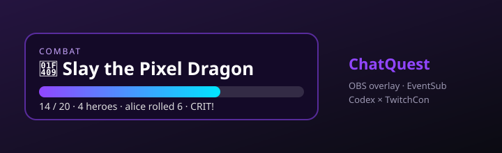

<p align="center">
  
</p>

<h1 align="center">ChatQuest Overlay</h1>

<p align="center">
  <b>Twitch chat spawns short co-op quests.</b><br>
  A Node bot drives a transparent OBS browser-source overlay — typed quests, dice rolls,<br>
  party chips, follow/sub/raid boosts, optional sound cues, and celebration FX.
</p>

<p align="center">
  <a href="https://devpost.com/software/chatquest-overlay"></a>
  <a href="https://youtu.be/4KVKrxAF93o"></a>
  <a href="https://github.com/barood-labs/chatquest/actions/workflows/ci.yml"></a>
  
</p>

<p align="center">
  <a href="https://youtu.be/4KVKrxAF93o"><b>▶ Watch the demo</b></a> ·
  <a href="https://devpost.com/software/chatquest-overlay">Devpost entry</a> ·
  <a href="docs/ARCHITECTURE.md">Architecture</a>
</p>

Built for the [Codex × TwitchCon Hackathon](https://twitchcon-codex.devpost.com/).

## Demo

https://youtu.be/4KVKrxAF93o

Local control deck (mock, no Twitch needed):

```bash
npm install
npm run start:mock
# open http://localhost:3000/control/   ← simulate quests + live overlay preview
# open http://localhost:3000/overlay/   ← OBS browser source (1920×1080, transparent)
```

## Features

- **Typed quests** — combat · escort · puzzle · rescue · hack · raid · survival (`!quest combat`, `!quest list`)
- **OBS-ready HUD** — progress bar, party chips, crit dice, themed accents, confetti on clear
- **EventSub boosts** — follows / subs / raids start or boost the active quest (scoped failures are non-fatal)
- **Optional sound cues** — mute toggle on the overlay (Web Audio; off by default persistence via `localStorage`)
- **Control deck** — `/control/` posts to `/api/test/*` so judges can click through offline
- **Mock CI** — `npm run smoke` boots mock mode and exercises the full lifecycle

## Chat commands

| Command | Action |
| --- | --- |
| `!quest` / `!quest start` | Start a random co-op quest |
| `!quest combat\|escort\|puzzle\|…` | Start a quest of that type |
| `!quest list` | List quest types in chat |
| `!join` / `!quest join` | Join the party |
| `!roll` | Roll a d6 toward the goal (6 = crit) |
| `!progress` / `!quest progress` | Show progress in chat |
| `!quest stop` | End the current quest |
| `!help` | List commands |

## Setup

1. Node 20+. Run `npm install`.
2. Twitch app at https://dev.twitch.tv/console/apps (OAuth redirect `http://localhost:3000`).
3. `cp .env.example .env` and fill in:
   - `TWITCH_CLIENT_ID` / `TWITCH_CLIENT_SECRET` — app credentials (Helix + EventSub)
   - `TWITCH_BOT_TOKEN` — user access token with:
     - `chat:read chat:edit` — IRC chat bot
     - `moderator:read:followers` — `channel.follow` EventSub (v2)
     - `channel:read:subscriptions` — `channel.subscribe` EventSub
     - (raid needs no extra scope)
   - `TWITCH_BOT_USERNAME` — bot login (e.g. `satrtools`)
   - `TWITCH_CHANNEL` — channel to join (e.g. `satrtools`)
   - `TWITCH_BROADCASTER_USER_ID` / `TWITCH_MODERATOR_USER_ID` — optional; resolved via Helix when omitted
   - `PORT` — default `3000`
   - `CHATQUEST_MOCK=1` — skip Twitch chat + EventSub
   - `CHATQUEST_FOLLOW_BOOST` / `CHATQUEST_SUB_BOOST` / `CHATQUEST_RAID_BOOST_CAP` — defaults 3 / 6 / 15

Never commit `.env` or `CODEX_SESSION_ID.txt`.

## Run

```bash
npm start          # server + overlay + Twitch bot + EventSub
npm run start:mock # never connects to Twitch
npm run smoke      # automated mock smoke test
npm run dev        # restart on file changes
```

## EventSub (WebSocket)

Connects to `wss://eventsub.wss.twitch.tv/ws` after `session_welcome`:

| Event | Behavior |
| --- | --- |
| `channel.follow` (v2) | Starts a quest if none active; otherwise boosts |
| `channel.subscribe` (v1) | Starts or boosts (larger boost) |
| `channel.raid` (v1) | Starts or boosts (scaled by viewers, capped) |

If a scope is missing (common for follows/subs), that subscription logs a warning and the rest keep working — chat + raids still demo cleanly.

## OBS

Add a **Browser Source** → `http://localhost:3000/overlay/` at 1920×1080. Transparent background. Sound cues are optional (speaker icon on the HUD).

## Test without Twitch

```bash
npm run start:mock
curl -X POST 'localhost:3000/api/test/quest?type=combat'
curl -X POST 'localhost:3000/api/test/join?user=alice'
curl -X POST 'localhost:3000/api/test/roll?user=bob'
curl -X POST 'localhost:3000/api/test/follow?user=newbie'
curl -X POST 'localhost:3000/api/test/subscribe?user=patron'
curl -X POST 'localhost:3000/api/test/raid?user=raider&viewers=12'
curl localhost:3000/api/state
curl localhost:3000/api/catalog
```

## Links

- Devpost: https://devpost.com/software/chatquest-overlay
- Demo video: https://youtu.be/4KVKrxAF93o
- Architecture: [docs/ARCHITECTURE.md](docs/ARCHITECTURE.md)
- Contributing: [CONTRIBUTING.md](CONTRIBUTING.md)

## License

MIT — see [LICENSE](LICENSE) when present; otherwise © barood-labs, use freely with attribution.
